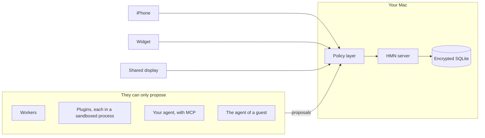

# HMN


**One private record of your life. Agents read up to a limit, and they can only propose.**

HMN (short for "human") is a store for the facts of one life: people, dates, tasks, projects, notes, and places. It runs on your own Mac. Your iPhone, a widget, and a shared display are windows onto it. An AI agent connects to it with MCP.

Two rules make it safe to connect an agent:

1. **Each row has a tier, and each reader has a ceiling.** The tiers are Public, Household, Personal, Private, and Sealed. A row above the ceiling of a reader is absent for that reader. One policy layer decides this for the phone, the widget, the display, and each agent.
2. **Software cannot write.** A worker, a plugin, an import, or an agent files a proposal. You approve it, or a rule that you set accepts it. You can undo an accepted change.

HMN is a store. It is not an agent runtime, and it has no chat. Use it with the agent that you already have, for example Claude Code, Claude Desktop, OpenClaw, or OpenJarvis.

## Status

Read this before you put real data in. The dates are from 2026-11-19.

- HMN is not released. One person builds it for personal use, and the repository is being prepared for a public release.
- The server has 284 tests. CI runs them on Linux and on macOS, and CI makes a real install on a macOS runner.
- The iPhone app and the menu bar app compile in CI. The iPhone app was run in the simulator, not on a real iPhone.
- No second person has reviewed the security design. Do not rely on the encryption until that review is done. [docs/SECURITY.md](docs/SECURITY.md) lists what is enforced and what risks remain.
- There is no App Store build. You build the iPhone app from the source.

## What it does

- **Calm screens.** Today, the week, what is coming, and your commitments. No streaks, no scores, and no feed.
- **Capture.** An inbox on the phone, from the share sheet, from Siri, and from an agent.
- **A calendar mirror.** HMN reads the ICS address of a calendar every 15 minutes. The calendar stays the source of truth, and HMN does not write back.
- **Workers.** Six small jobs on your Mac propose a morning list, a week review, reminders about people, and more. They run with no model, with a local model, or with a cloud model that you enable for one worker.
- **A surface for agents.** Ranked search, links between entities, a proposal contract with an idempotency key, and a log of what each agent read. Each agent has its own key. See [docs/CONNECT-AN-AGENT.md](docs/CONNECT-AN-AGENT.md).
- **Limits that you can see.** An agent key reads up to Personal. You can give one key the Private tier for a time, after a preview of what that adds. No key reads Sealed.
- **Busy times and a guest.** The agent of a friend can get the times in which you are busy, with no titles, and can propose a meeting. You approve it on the phone.
- **Your own words.** Areas and kinds are rows that you add. The rules read a role, not a name, so the code names no part of one life.
- **A shared display.** A TRMNL e-ink display shows Public rows only.

## How it fits together



| Reader | Ceiling |
| --- | --- |
| Shared display, lock screen | Public |
| Widget | Personal |
| Unlocked phone | Private |
| Vault on the phone, after Face ID or the passcode | Sealed |
| Agent key | Personal. Private only while your grant for that one key is open. Never Sealed. |
| Guest | Public |

The database file is encrypted. Sealed fields are encrypted a second time with a separate key. The key that opens the database is in the macOS Keychain. An audit log with a hash chain records each Private and Sealed read.

## What leaves your Mac

HMN itself sends nothing about your life to another service.

- It opens an outbound connection only for a thing that you turn on: a calendar that you add, a local model that you download, or a cloud model that you enable for one worker.
- The server has no telemetry and no account.
- An agent that you give a key sends what it reads to its own model. HMN cannot take that back. This is the reason for the ceiling, the preview, and the end date of a grant.

## Install on a Mac

You need macOS 14 or later, with FileVault on, and `git`. The install adds [Bun](https://bun.sh) if it is not there. The server has no npm dependencies.

```sh
git clone https://github.com/hmn-tools/HMN.git ~/hmn
cd ~/hmn
deploy/hmn install --empty
deploy/hmn status
```

- `--empty` starts a graph for your own data. `--demo` starts with a fictional demonstration, for a test. The demonstration cannot be removed later as a whole.
- The install shows a recovery passphrase of 13 words, once, to a person at a terminal. Write it on paper.
- The keys go into your login Keychain. The server starts at login, from launchd, and listens with TLS on port 8787.
- Do not open port 8787 on your router. Use your home network, or Tailscale, when the phone is away.

`deploy/hmn` also has `start`, `stop`, `restart`, `logs`, `pair`, `passphrase`, `update`, and `uninstall`. The full guide is [docs/MAC-MINI.md](docs/MAC-MINI.md).

## Try it with no install

This starts a server with the fictional demonstration in a temporary folder. It makes no Keychain call. Do not use it for real data, because the key is in the same folder as the data.

```sh
cd server
bun test
HMN_INSECURE_DEV_KEK=1 HMN_DATA_DIR=/tmp/hmn-trial HMN_HOST=127.0.0.1 bun src/index.ts
```

The first start prints three keys. In a second terminal, read the Today screen with the owner key:

```sh
curl --cacert /tmp/hmn-trial/tls/ca.crt -H "Authorization: Bearer $HMN_OWNER_KEY" -H "X-HMN-Surface: phone" \
  https://127.0.0.1:8787/api/v1/screens/today
```

More examples are in [docs/RUNNING.md](docs/RUNNING.md).

## Connect an agent

On the same Mac, an MCP client starts a small program that is a pipe to the running server. For Claude Code:

```sh
claude mcp add hmn -- bun ~/hmn/server/src/stdio.ts \
  --ca "$HOME/Library/Application Support/HMN/data/tls/ca.crt"
```

The agent gets tools that read and tools that propose. No tool writes the graph. [docs/CONNECT-AN-AGENT.md](docs/CONNECT-AN-AGENT.md) has the tools, the proposal contract, one key for each agent, and the settings for other clients. An agent that is not on your Mac uses a separate port that is off by default. See [docs/EXTERNAL-AGENTS.md](docs/EXTERNAL-AGENTS.md).

## The iPhone app

Open `ios/HMN.xcodeproj` in Xcode, select your team, and run the app on your phone. Then, on the Mac:

```sh
deploy/hmn pair
```

The command prints a pairing code, the certificate fingerprint, and the server address. Type the three values into Settings in the app. The phone stores its key in the Keychain, and it accepts only the certificate with that fingerprint. The detail is in [docs/RUNNING.md](docs/RUNNING.md).

## Documents

| Document | What it has |
| --- | --- |
| [docs/PRODUCT.md](docs/PRODUCT.md) | What HMN is for, its principles, and what it will not do. |
| [docs/STRATEGY.md](docs/STRATEGY.md) | Where HMN sits among other software, and the decisions. |
| [docs/SECURITY.md](docs/SECURITY.md) | What is enforced, the threat model, and the risks that remain. |
| [docs/SCHEMA.md](docs/SCHEMA.md) | The data model, the API, the MCP tools, and the rules. |
| [docs/UX.md](docs/UX.md) | The screens and their text. |
| [docs/CONNECT-AN-AGENT.md](docs/CONNECT-AN-AGENT.md) | How to connect an agent, and what it can rely on. |
| [docs/EXTERNAL-AGENTS.md](docs/EXTERNAL-AGENTS.md) | An agent away from your Mac, and a guest. |
| [docs/MAC-MINI.md](docs/MAC-MINI.md) | The install, the menu bar app, and the daily commands. |
| [docs/RUNNING.md](docs/RUNNING.md) | A run from the source, Docker, `curl`, the first run, and the plugins. |
| [docs/TAILSCALE.md](docs/TAILSCALE.md), [docs/TRMNL.md](docs/TRMNL.md), [docs/LOCAL-MODELS.md](docs/LOCAL-MODELS.md) | The phone away from home, the display, and local models. |
| [docs/ROADMAP.md](docs/ROADMAP.md) | What is built, what is open, and the order. |

## Development

```sh
cd server
bun test
```

The server is TypeScript on Bun, with SQLite and no npm dependencies. The iPhone app and the menu bar app are SwiftUI. The design tokens are in [server/src/tokens.ts](server/src/tokens.ts) and [ios/HMN/Theme/Theme.swift](ios/HMN/Theme/Theme.swift). The test data is fictional.

Read [CONTRIBUTING.md](CONTRIBUTING.md) before you send a change. A change keeps the two rules at the top of this page.

## What is not built

- A release for the App Store, for Android, or for the web.
- A full CalDAV client. The calendar mirror reads the ICS address of a calendar.
- Push notifications. The server does not send a notification to the phone.
- A sync with another system. An import from another system is one-time, and you approve each pass.
- A marketplace or a plugin kit. The public interface is two contracts: the read contract and the proposal contract. [docs/STRATEGY.md](docs/STRATEGY.md) has the read contract, and it lists the parts that are not built.

## Licence

The source code is under the Apache License, Version 2.0. See [LICENSE](LICENSE) and [NOTICE](NOTICE). The fonts and their licence are in [THIRD_PARTY.md](THIRD_PARTY.md).

The licence does not cover the name "HMN" or the mark. See [TRADEMARKS.md](TRADEMARKS.md).
