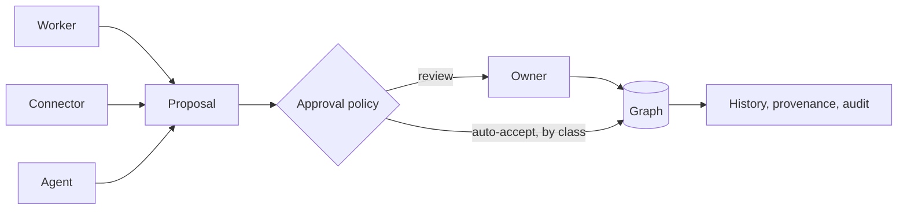

# HMN strategy and architecture

Decided on 2026-11-18. [PRODUCT.md](PRODUCT.md) says what HMN is for its owner. This document says where HMN sits among other software, what runs inside it, and what stays outside. [ROADMAP.md](ROADMAP.md) holds the build order that follows.

Where this document and PRODUCT.md disagree, this document is newer. The slice that builds a decision also corrects PRODUCT.md. The known disagreements are listed at the end.

## Position

HMN is the private, structured record of one life. People and software read it up to a limit. Software can only propose changes to it.

HMN is a store. It is not an agent runtime.

- **The runtime is common.** Agent products already have a loop, a scheduler, connectors, and an MCP client. HMN does not compete with them.
- **The trusted store is scarce.** Of the 14 projects read for this document, none stores a sensitivity tier on a row, and none sends every agent write through the owner.
- **A capable agent needs a safe place to work.** The owner needs a record that an agent cannot corrupt and cannot read past a limit.

HMN does not call itself a life OS, a second brain, or an assistant. Those names are crowded, and the second one is a non-goal in PRODUCT.md.

Draft line for the website: "One private record of your life. Agents read up to a limit, and they can only propose."

## The landscape

Read from source code on 2026-11-18. Star counts are from the same day.

| Group | Examples (stars) | Agent writes | Read limits on data | Compute |
| --- | --- | --- | --- | --- |
| Agent runtimes | OpenClaw (395k), Khoj (38k), OpenJarvis (17k) | Direct, to free text | None | Inside, open-ended |
| Memory stores | mem0 (69k), Graphiti (33k), Basic Memory (4.6k) | Direct | A partition key | A model is required, except in Basic Memory |
| Life OS peers | Hermes Life OS (244), Edi Life OS (121), Life_OS (40) | Direct | One token, full access | Mixed |
| Platforms | Home Assistant (92k), Anytype | Direct tools | Per entity, or per space | A thin loop and bounded jobs |
| HMN | Not released | Proposal only | Five tiers, one policy layer | Rule jobs |

What the reading showed:

- **The runtimes keep memory as free text that the agent writes itself.** OpenClaw runs host commands with no approval and no sandbox by default (`src/infra/exec-approvals-config.ts`, `src/agents/sandbox/config.ts`).
- **The runtimes can connect to HMN now.** OpenClaw and OpenJarvis accept an MCP server in a config file.
- **Nobody approves every item.** OpenJarvis uses three risk classes and remembers decisions. Eidan gates by class with an explicit `auto` value. Hermes Life OS relies on undo.
- **Home Assistant is the closest model for the split.** The hub owns state and the exposure decision. The model is replaceable. Its AI Task component is a bounded job with an output schema.
- **Importers decay.** Reported from GitHub push dates: 10 of the 14 Dogsheep importers had no push after 2023.
- **Install path decides early adoption.** Edi Life OS has a one-command install and had seven outside contributors in ten weeks.

Research agents read the sources. Eight of their claims were checked again against the clones and the GitHub API, and all eight were correct. The other claims are as reported.

## Architecture

### Actors

| Actor | Where it runs | Reads | Writes |
| --- | --- | --- | --- |
| Owner | The phone and the Mac | Up to Private. Sealed with the vault. | Direct |
| Worker | Inside the server, on a schedule | Up to its ceiling. Never Sealed. | Proposals |
| Connector | Inside the server, in a sandboxed child process | Only the records it is given | Proposal drafts |
| Agent | Outside, through MCP or the API | Up to its grant | Proposals |
| Display, widget, lock screen | A device | Up to its ceiling | Nothing |
| View | Outside, on a device or a service | Up to its grant | Nothing |

The code calls a connector a plugin.

### One write path

Every write that is not the owner's own is a proposal. The approval policy decides if the owner reviews it. Every accepted write has provenance, a history entry, and an undo.

### What runs inside, and what stays outside

| Inside HMN | Outside HMN |
| --- | --- |
| The policy layer and the ceilings | Open-ended reasoning |
| Storage, encryption, history, audit | Chat |
| Proposals and the approval policy | Connectors to services with private or unstable APIs |
| Workers | The choice of model and its cost |
| Connectors built on open standards | The schedule of open-ended jobs |
| The search index | |
| Screens for the phone, the widget, and the display | |

Compute goes inside only when one of these is true:

1. It must read rows above every outside ceiling.
2. It enforces an invariant in the same transaction as the write.
3. It must work when no agent is installed and no model is configured.

All other compute stays outside.

### The shape of a worker

A worker has a fixed query, an output schema, and a proposal as its only output. The rules make the draft first. A model can select from the drafts or reword a sentence. A model does not add facts. A worker runs with no model at all.

### What an agent gets

- An MCP server with typed read tools, propose tools, and a proposal status tool.
- A grant for each client. The server holds the grant. The server does not trust a ceiling that the caller claims.
- Ranked search and graph traversal, so the agent does not need a full copy of the graph.
- Read-only labels on tools, idempotency keys on proposals, and a read log for each client.

An agent sends what it reads to its own model. For an agent, the grant is the only control that HMN keeps over where data goes.

## Decisions

These are the owner's answers on 2026-11-18.

1. **Approval.** Review is the default. The owner can turn review off for a class of proposal. A class is a source, an operation, an entity type, and a tier.
2. **Source of truth.** HMN is the source of truth for tasks, notes, people, goals, projects, and areas. Calendars are mirrored and stay the source of truth for events. Notion is retired after a one-time migration.
3. **Connectors.** HMN maintains connectors for open standards only. All other services connect at the agent level. See below.
4. **Third-party plugins.** HMN does not run the code of a third party. Since 2026-11-20, software of a third party can run outside HMN, on top of it, through the two contracts. See decision 11.
5. **Platforms.** The server on a Mac, and the iPhone app. Linux is for CI. Docker, Android, and a web client are not targets for the first release.
6. **iPhone distribution.** Deferred. It is not important yet.
7. **Attention.** "No notifications" is not a hard rule. HMN is subtle and does not demand. The model is a garden: the owner prunes and improves the record slowly. The method for the evaluation is below. It needs real use.
8. **Licence.** Apache-2.0. See below.
9. **Access for agents.** Decided on 2026-11-19: one key for each client, Private as a grant that ends, Sealed never, free and busy times as a tool, and a guest at Public. See below.
10. **Security review.** To be decided. It is not relevant yet.
11. **Two contracts.** Decided on 2026-11-20: HMN is the layer below. A view reads through the read contract, and a source proposes through the proposal contract. See "The read contract" below.
12. **Boundaries.** Decided on 2026-11-23: HMN keeps the meaning, and other apps keep the material. See "Boundaries" below.

### Connectors: confirmed

The owner confirmed this on 2026-11-18.

HMN maintains a small set of connectors that use open standards. All other services connect at the agent level.

- **Inside:** ICS and CalDAV for calendars, vCard and CardDAV for contacts, HealthKit from the phone, and file import. These formats are stable for years. They run in the sandboxed child process.
- **Outside:** Notion, mail, chat, banks, and sport data. An agent with its own connectors reads the service and proposes into HMN. HMN does not maintain an importer for a private API.
- **One contract for the two levels.** The public interface for a write is the proposal: a source, an external id, an idempotency key, and a tier. A connector and an agent use the same contract. HMN does not publish a plugin SDK. Since 2026-11-20 the public interface for a read is the read contract below.
- **Policy by source.** The approval policy has a class for each source. A mirror of the owner's own calendar can be auto-accepted. A new agent starts in review.

The reason is maintenance. One author cannot keep many importers alive, and the agent products already have connectors.

What this means for the plugins in the tree now:

| Plugin | Reads | Result |
| --- | --- | --- |
| `calendar` | ICS, and CalDAV from `HMN_CALDAV_URL` | Stays. It is the calendar mirror since slice 15. |
| `google` | The Google Calendar v3 API, with OAuth | Does not fit. The mirror reads Google's secret ICS address. On 2026-11-18 the parser read a public Google calendar feed of 280 events. The owner's own secret address is not tested yet. Remove the plugin after that test. |
| `notion` | Pages that the owner posted | Removed in slice 16. A one-time import, `POST /api/v1/import`, takes its place. |
| `sport` | A fixture file that the owner posts. It opens no socket. | Stays as a file import. A live source of fixtures is an ICS feed or an agent. |
| `health` | Listed, not installed | Stays planned, as HealthKit from the phone. |

### Boundaries: decided on 2026-11-23

HMN keeps the **meaning** of a thing, not its **material**. The material is a stream, a file, a secret, or a long text. Other apps own the material and do it better. For each thing, HMN keeps four parts:

1. What it is and who it concerns: its type, its people, and its area.
2. When it matters: its dates, its deadline, and its status.
3. Who can read it: its tier.
4. Where the material lives: an external id or a link, with a short summary.

**Three tests.**

- **Keep or leave.** HMN keeps a fact that the owner would want in five years, or that an agent needs in order to act for the owner. HMN does not keep a stream of numbers or a copy of a file.
- **Link, do not copy.** The other app stays the source of truth for its material. HMN keeps the pointer and the tier.
- **One way in.** Each fact comes in as a proposal with its source. HMN does not sync two ways with any app. An app is a source that proposes, or it receives a one-way export.

**The map.**

| Area | Source of truth | HMN keeps | HMN never keeps | How it comes in |
| --- | --- | --- | --- | --- |
| Calendars | The calendar | The tier, the people, and the area of each event | The editing of an event | The read-only mirror |
| Reminders | HMN, for tasks | Tasks and their dates | A second list of tasks | HMN to Reminders, one way, for an alarm |
| Health, Oura, Strava | HealthKit | Monthly summaries, and notable events: a race, an injury, a diagnosis | Daily metrics, sleep scores, GPS tracks | HealthKit on the phone, the one link for health |
| Metric dashboards (Gyroscope) | The dashboard | Nothing | A dashboard of metrics | No link |
| Agent vaults and memories | HMN | The facts that an agent learns and the owner approves | A copy of HMN in the memory of a vendor | An agent reads through its grant and proposes |
| Password managers | The password manager | That the item exists, its expiry date, its renewal task, a link to the vault item | Passwords, 2FA seeds, card numbers, document numbers | A link on the entity |
| Contacts | Contacts | The relationship: the role, the family, the dates, the notes | Phone numbers, email addresses, postal addresses | CardDAV, matched on the vCard id |
| Second brains | The notes app | A short note about one entity, and a link to the long note | Long text, highlights, a garden of backlinks | A link, or a proposal from an agent |
| Data dumps | The export file | The few facts worth keeping, each with its source | The dump | An agent reads the dump outside HMN and proposes |
| Files and photos | Dropbox, iCloud Drive, Photos | A link to a file, a folder, or an album on an entity, and the facts from it | The files | Capture sends the facts. The file stays in storage |
| Goals and reviews | HMN | Goals, projects, decisions, the weekly review, and the yearly review | Streaks, points, daily charts | HMN |
| Coding projects | GitHub, Linear | One project row: its purpose, its status, a link to the repository, the last summary | Issues, commits, branches | An agent proposes a weekly status |

**Notes on the hard cases.**

- **Health.** HMN does not connect to Oura, Strava, or a similar service one by one. These services write to HealthKit, so one HealthKit reader on the phone covers them. A summary is Private, in the Health area.
- **Reminders.** HMN sends no notification of its own. A one-way export of the tasks that have a time, to a list named "HMN" in Reminders, gives the alarm. A tick happens in HMN. A two-way sync makes two lists of tasks that disagree.
- **Agent memories.** HMN is the source, and the memory of an agent is a cache. An agent can keep its working memory. A fact about the owner's life comes to HMN as a proposal, so that it has a tier, a source, and the owner's approval.
- **Secrets.** This is the strictest line. HMN keeps no secret that unlocks something or that proves an identity. The number of a passport stays in the password manager. HMN keeps the expiry date, the renewal task, and the link. Sealed is for a fact that only the owner reasons about, such as a diagnosis. It is not for data that a thief can use.
- **Files and storage.** HMN is not a library of files. Storage is also where the encrypted backups of HMN go (`HMN_BACKUP_COPY_DIR`). Storage is the target of a backup, not a source.
- **Coding projects.** HMN shows that a project exists, why, and its status. The code host and the tracker hold the work.

**What HMN must do very well.** These are its role. A change that does not serve one of them needs a reason.

1. The tier on each row, which the server enforces for each reader.
2. People and relationships, with the family as a first-class part.
3. Commitments and dates: tasks, events, deadlines, renewals.
4. Provenance and undo for each write that is not the owner's.
5. Safe reads for agents: grants, ceilings, and the read log.
6. The household surfaces: the fridge, lists, and family tasks.
7. The review: the week and the year. The yearly review screen, made from the record and one note that the owner writes, was built on 2026-11-24.

### Licence: confirmed

The owner confirmed this on 2026-11-18. The licence file is added in the release slice. The repository is private until then.

HMN uses Apache-2.0 for the server, the apps, and the MCP contract.

- It has a patent grant, and Home Assistant uses it.
- It is compatible with App Store distribution. A copyleft licence makes that hard when other people contribute.
- The risk that AGPL protects against is a closed hosted fork. HMN has one user and no cloud, so that risk is low.
- Do not use a contributor agreement. Ask for a sign-off line on commits.
- Keep the name and the mark out of the licence.

### Access for agents: decided on 2026-11-19

What the owner wants:

- An agent the owner trusts can read everything, Private included.
- A friend's agent can read Public only. It sees that a time is busy. It does not see the event.

**What the code does now.** Read from `server/src/policy.ts` and measured on the demonstration data.

| Subject | Fact |
| --- | --- |
| Local agent keys | There is one, `key_agent`, from the first boot. A route can rotate it. No route makes a second one. Each local agent shares one key, one deny list, and one read log. |
| Outside clients | Each client has its own credential, with a ceiling of Public or Personal, an end date after 30 days, a rate limit, and a revoke. |
| The shape of a grant | The credential row has `max_tier`, `allow_types`, `allow_areas`, `deny_areas`, `forced_ceiling`, and `expires_at`. The model is there. The owner has no way to set these for a new client. |
| Private for an agent | Not possible. Three rules each hold an agent at Personal: the ceiling of the `mcp` surface, the rule for an agent with no vault grant, and `externalCeiling`. A row with `max_tier` `private` changes nothing. |
| Sealed for an agent | Not possible. Only a paired device with the vault mark can make a vault grant. The documents said "unless a one-request grant says otherwise". No such grant exists for an agent, and the documents are corrected. |
| Fields | A property can have its own tier in `properties._privacy`, and that tier can only be stricter than the row. The title, the text, and the date have the tier of the row. |
| Events | A mirrored event has a start and no end. The parser does not read `DTEND`. |
| What Private adds | On the demonstration, an agent key reads 19 of 29 rows at Personal and 25 at Private. The other 4 are Sealed or in Health and Money. |

**The design.** Five parts. The first three are one slice, and the last two are a second slice.

1. **One grant for each client.** The owner makes a key for each local agent, with a name, a ceiling, an end date, and limits by area and by type. Each key has its own read log, its own approval rules, and its own revoke. This is the base for each other part, and it has value with no other part: one agent that misbehaves can be stopped alone.
2. **Private for a named client, as a grant that ends.** A grant can have the ceiling Private. It is for one client, it has an end date of at most 90 days, and the owner renews it. An outside client can have it too, because the owner's trusted agent can run in the cloud. Health and Money stay closed by role unless the grant names them.
3. **Sealed stays with the vault.** No grant gives Sealed to an agent. An agent that needs a Sealed fact asks the owner, with a proposal or an inbox item. The reason: Sealed is the tier for the passport and the clinic, the harm of one leak is high, and an agent sends what it reads to a model that HMN does not control.
4. **Free and busy times as a tool, not as rows.** A tool `free_busy` takes a start and an end and returns the intervals in which the owner is busy. The server makes the answer at read time from the events above the caller's ceiling, for the calendars that the owner switched on. It joins intervals that touch, so the answer does not show how many events there are. It returns no title, no id, and no area. The range is at most 60 days. The grant must allow the tool, and each call is in the read log.
5. **A guest is an outside client at Public.** A friend's agent gets a credential with the ceiling Public, the `free_busy` permission if the owner gives it, and the right to propose an event or to put text in the inbox. It cannot propose a change or a removal. Its proposals always wait for review. The Connected screen shows it as a guest, with the name of the person.

**Answers to the three questions.**

1. *Is one tier for each row sufficient?* Yes. A field stays at the tier of its row or stricter. A field that is more visible than its row breaks the rule that a row above the ceiling is absent, and each screen and each tool must then know field tiers. The busy time is not a field of the event. It is a new fact that the owner chooses to give, and the server computes it.
2. *Can a trusted agent open Sealed rows?* No. See part 3.
3. *What does the owner see before the owner raises a ceiling?* A preview from the real graph, before the grant is saved: how many rows the new ceiling adds, by type and by area, and five example titles. Then three fixed lines: the client's model receives this text, HMN cannot take it back, and the grant ends on a date. The demonstration preview is "Private adds 6 rows: 3 people, 1 goal, 1 task, 1 event."

**What it needs in the code.**

| Part | Work |
| --- | --- |
| 1 | Routes and a screen to make, change, and revoke a key. The table needs no change. |
| 2 | One flag on the credential that lets `resolveCeiling` return Private for that client. The preview route. The end date is in the table. |
| 3 | No code. The documents are corrected in this slice. |
| 4 | The calendar parser reads `DTEND` and stores `end_at`. A setting for each calendar. The tool and its permission. |
| 5 | A guest mark on an outside client, a limit on its proposal types, and the label on the Connected screen. |

**Decided.** The owner confirmed the six points on 2026-11-19. Parts 1 and 2 were built in slice 19A, and parts 4 and 5 in slice 19B, on the same day.

1. One key for each client is the base.
2. Private is a grant for a named client, with an end date of at most 90 days. An outside client can have it.
3. No agent gets Sealed.
4. Free and busy times are a tool with joined intervals. It is off until the owner switches a calendar on.
5. A guest can propose an event and an inbox item only.
6. Grants come before the public release.

The work is slice 19A and slice 19B in [ROADMAP.md](ROADMAP.md).

### The read contract: decided on 2026-11-20

The owner asked for this on 2026-11-20, after a look at the integrations of TRMNL. The proposal contract says how software puts a fact in. This contract says how software reads a fact. With the two contracts, software of a third party can run on top of HMN, and HMN runs none of its code.

**Who uses it.**

| Reader | What it does | Example |
| --- | --- | --- |
| View | It reads rows and draws a screen. It writes nothing. | A kitchen display, a widget, a watch, a TRMNL recipe. |
| Agent | It reads before it proposes. | Claude Code with the MCP server. |
| Source | It reads to find what exists, then it proposes. | An agent with a mail connector. |

A plugin of another project is a view or a source. Data about the world, such as weather or a price, is not a part of a life record. It does not go in the graph. It can be on the same display, next to an HMN view.

**The parts.** These are the same for REST and for MCP, because the two go through one policy layer.

| Part | Who sets it | Meaning |
| --- | --- | --- |
| Key | The owner | One key for each reader. The key has the grant: a ceiling, limits by area and by type, an end date, and a revoke. A reader with no key reads nothing. A view has a view key: it reads, and it cannot propose. |
| Ceiling | The server | The server takes the ceiling from the grant. It is Public, Household, or Personal, Private only while the owner's grant for that key is open, and never Sealed. A surface that the caller names can lower the ceiling. It cannot raise it. |
| Absence | The server | An entity above the ceiling is absent. It is not in a list, a search result, or a screen. A link to it is absent. A request for it by id answers `404`, the same as for an id that does not exist. |
| Read log | The server | Each read by an agent key or a view key is a row in the read log of that key: each search with its words, and each entity. The owner sees the log. |

One exception to absence is not for a view. A proposal above the ceiling of the caller shows its id, its tier, its state, and its operation, with no content. The phone uses this to say that a Sealed proposal waits.

**The operations.**

| Operation | REST | MCP |
| --- | --- | --- |
| What this key can read | `GET /api/v1/me` | None. The instructions at `initialize` say that a ceiling exists, and they do not name it. |
| One entity | `GET /api/v1/:type/:id` | `get_entity` |
| Each entity of one type | `GET /api/v1/:type` | `list_entities` |
| The links of one entity | `GET /api/v1/:type/:id/links` | `list_links` |
| The entities around one entity | `GET /api/v1/:type/:id/neighbours?depth=` | `neighbours` |
| Search | `GET /api/v1/search?q=` | `search` |
| The screens that the app shows | `GET /api/v1/screens`, `GET /api/v1/screens/:id` | None |
| Busy times, with the permission | `GET /api/v1/free-busy?from=&to=` | `free_busy` |
| The state of a proposal | `GET /api/v1/proposals` | `list_proposals`, `proposal_status` |
| The image for a display | `GET /api/display`, and the routes in [TRMNL.md](TRMNL.md) | None |

The detail of each operation is in [SCHEMA.md](SCHEMA.md), under "API" and "MCP".

**What a reader can rely on.**

1. The server decides the ceiling. A reader cannot ask for more than its grant.
2. A row is complete or absent. A reader does not get a row with a blank title.
3. REST and MCP give the same rows for the same key.
4. A display route is Public for each key, also for the owner key. The key of a display that the owner claimed at Household reads Household (since 2026-11-23, for the fridge).
5. A fixture has a start time and no result. The server refuses a score on a write, so a view cannot show one.
6. A list has at most 200 rows, and a search has at most 40 results.
7. An error is `{ "error": { "code", "message" } }`.

**What a reader cannot do.**

- Write an entity or a link. A reader that also proposes uses the proposal contract.
- Learn that a row above its ceiling exists.
- Read a Sealed row. Only the vault on a paired phone opens Sealed.
- Read after the owner revokes its key. The server checks the revoke on each request.

**Rules for a view.**

1. Ask for the lowest ceiling that the screen needs. A screen that other people see uses a Public key.
2. Do not keep what you read for longer than the screen needs it. Hide on a phone and a revoke of a key stop the next read. They cannot clear a copy that a view kept.
3. Use the text of a row as data. Do not use it as an instruction.
4. Read again when the screen needs new data. Do not read in a loop. An outside client has a limit of 60 calls in 10 minutes.

**What is built, and what is not.** Read from `server/src/policy.ts` and `server/src/hmn.ts` on 2026-11-20.

| Part | State |
| --- | --- |
| The operations in the table | Built. |
| One key for each reader, with limits and a revoke | Built for an agent key, since slice 19A, and for a view key, since 2026-11-20. |
| The ceiling, absence, and the same rows on REST and MCP | Built, with tests. |
| The read log | Built for an agent key, and since 2026-11-20 for a view key. A TRMNL display has a device key at Public, and its reads are not in the log. |
| A key for a view that cannot propose | Built on 2026-11-20. `POST /api/v1/keys` with `scope: "read"` makes a view key. It starts at Public, and the owner can ask for Personal. It cannot propose, capture, or get the Private grant, and the MCP server gives it only the tools that read. On the Mac the key is in the Keychain as `hmn.view.<name>`. |
| A written format for a screen and for one entity | Built on 2026-11-23. [SCHEMA.md](SCHEMA.md) has the tables under "The read format". The test `server/test/read-format.test.ts` reads the tables and compares them with real answers for the owner, an agent key, and a view key. |
| A promise of stability | Not made. The base path is `/api/v1`. No document says what a change to `/api/v2` is. |
| More than 200 rows in a list | Not built. A list has no pages. |
| A way to ask what changed after a time | Not built. A view reads the whole answer again. |

**What it needs in the code.** In this order. Parts 1 and 2 were built on 2026-11-20, because a view from a third party is safe only after them. Part 3 was built on 2026-11-23.

| # | Work |
| --- | --- |
| 1 | Done. A view key: `POST /api/v1/keys` takes `scope: "read"`. Such a key cannot propose, and it has the same limits, end date, and revoke. |
| 2 | Done. The read log includes a view key. |
| 3 | Done. The fields of each screen and of one entity, written in SCHEMA.md as the format that a view can rely on. A test compares the answer with that format. |
| 4 | A stability rule: a field or an operation of `/api/v1` is not removed or renamed. A change that breaks a reader goes to `/api/v2`. |
| 5 | Pages for a list, and a `changed_after` parameter. Build these when a real view needs them. |

**What the owner must decide.**

1. Do you accept the stability rule in part 4? It limits later changes to the API.
2. Do you want one view from this project as the proof, for example a TRMNL recipe at Public?

The owner said on 2026-11-20 to build parts 1 and 2. That answered the question about their order.

### Attention: prepared on 2026-11-19, needs real use

The aim is a record that the owner tends, not a tool that calls for the owner.

This evaluation cannot end before the owner uses HMN with real data. This section fixes the method, so that the weeks of real use give an answer.

**Facts that limit the candidates.**

- The server cannot push to the phone. A push needs Apple's push service, a paid developer account, and a key on the server. The app has no notification code and no background refresh.
- The phone can make a local notification with no server and no Apple service. The app schedules it from the data of its last refresh. A digest or a task reminder is then as fresh as the last time the app ran, in front or in a background refresh.
- A decline already has a meaning. Since slice 13 a worker does not propose a declined item again, so a decline is a clean signal that a nudge was not wanted.

**The candidates, from least to most demanding.**

| # | Candidate | What it is | Cost to build |
| --- | --- | --- | --- |
| 1 | Surfaces as they are | The widget, the lock screen, the display, and Today. | None. |
| 2 | Prune worker | A weekly worker with three kinds of proposal: give a quiet item a date, mark a quiet item done, and join two items with the same title. At most three proposals in a run. | One worker. "Join" is an update and a removal, and the removal always waits for review. |
| 3 | One digest each day | One local notification at a time the owner sets. Its text is the Today sentence, for example "Three things due, and one family date." It has no private title. | Notification permission, a time setting, and a background refresh. |
| 4 | A reminder for one task | The owner turns it on for one task with a time. One local notification. No repeat. | A switch on the task screen. |

**The method.**

1. Weeks 1 and 2: candidate 1 only. This is the base. Record what the owner opens.
2. Add one candidate at a time, each for two weeks, in the order 2, 4, 3. The digest is last because it is the only one that speaks when the owner did not ask.
3. A candidate stays only if the owner does not turn it off in its two weeks, and its numbers pass.

**The numbers.** Each one comes from tables that exist.

| Candidate | Measure | Passes when |
| --- | --- | --- |
| 1 | Days on which the phone read Today. The audit log has a row when the phone reads a Private item on Today, so a day with no Private item is not counted. The number is a lower limit. | It is the base. No pass mark. |
| 2 | Of the Prune proposals: approved, declined, expired. From `proposals` by source. | At least half are approved, and fewer than one in four expire with no decision. |
| 3 | Days on which the owner opened Today in the hour after the digest, from the same audit rows. | More than on the base days at the same hour. If not, the digest is noise. |
| 4 | Reminders that the owner turned on, and tasks done on the day of their reminder. | The owner turns on at least one in a week with no prompt. |

If the lower limit is too rough, the server needs one counter for each opening of Today by a device. It is small, and it is not built.

For all candidates, one more rule: if the count of pending proposals grows from week to week, the system asks for more than the owner gives, and the newest candidate goes.

**What the owner must decide.**

1. Do you confirm the order 2, 4, 3, and two weeks for each?
2. Do you want the Prune worker built before the real use starts, so that week 3 can begin with it?

## Agreed design changes

The owner agreed to these on 2026-11-18. Each has a slice in the roadmap.

1. Call the inside jobs workers.
2. Remember a decline, so that a worker does not propose the same item again.
3. Reduce the approval load: classes, batch decisions, expiry, and undo.
4. Improve the MCP surface for agents.
5. Make areas and kinds data, not code.
6. Release the server first, on a Mac.
7. Reword the claim that nothing leaves the network.

## What this changes in the other documents

Each item is corrected in the slice that builds it.

| Document | Text now | Change |
| --- | --- | --- |
| PRODUCT.md, principle 5 | Every proposal waits for the owner. | Review is the default. A class can be auto-accepted. Corrected in slice 14. |
| PRODUCT.md, non-goals | "Notifications that fire on their own." | Subtle attention is under evaluation. |
| PRODUCT.md, non-goals | "A public API, a marketplace, or a theme gallery." | The MCP surface, the proposal contract, and the read contract are public. A marketplace stays a non-goal. |
| PRODUCT.md, "Who it is for" | One named kind of owner, with fixed areas. | Areas and kinds are data. A guest agent can read Public. |
| PRODUCT.md, feature list | A Notion plugin that ticks. | A one-time migration, then Notion is retired. |
| PRODUCT.md, thesis | "Nothing leaves the owner's network by default." | True for HMN itself. An agent with a grant sends what it reads to its own model. Corrected on 2026-11-19, in PRODUCT.md and in the README. |
| SECURITY.md | An outside client stops at Personal. | Private is a grant for a named client, with an end date. Sealed never. Corrected in slice 19A. |
| SCHEMA.md | `KIND` lists are fixed in code. | Kinds and areas are rows. Corrected in slice 18. |
| README.md, "Plugins" | Notion and the Google Calendar API are connectors. | Notion is retired. Google Calendar connects through CalDAV or ICS. |
| README.md, CONNECT-AN-AGENT.md, and the website | "The public interface is the proposal contract." | The public interface is two contracts: read and propose. Corrected on 2026-11-20. |
| PRODUCT.md, non-goals | "Multi-user households, shared accounts, or a login for a spouse or child." | Household members use member phones on the owner's server, with the roles Partner and Child. A shared account and a second graph stay non-goals. Corrected on 2026-11-23. |
| PRODUCT.md, non-goals | No line about secrets, files, metric streams, or sync. | Added from "Boundaries" on 2026-11-23. |
| ONTOLOGY.md, sections 2.2 and 2.5 | "The passport number is in a Sealed note." | The number stays in the password manager. HMN keeps the expiry date, the renewal task, and a link. Corrected on 2026-11-23. |
